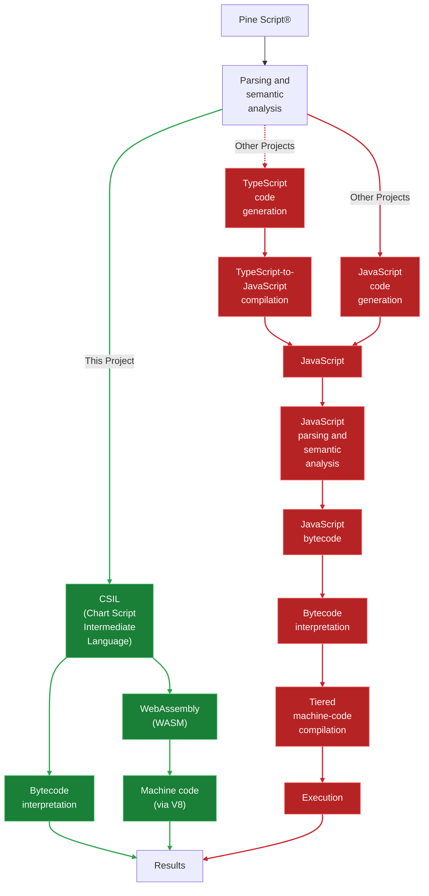

  <h1>
    <picture>
      <source media="(prefers-color-scheme: dark)" srcset="docs/assets/pinewasm-logo-dark.png">
      
    </picture>
  </h1>
  
<strong>Perfect for high-throughput backtesting and interactive scripting.</strong>

  
An independent Rust-based compiler for source written in Pine Script® v6,
  with feature coverage listed in the coverage matrix, targeting WebAssembly.

[**Try in AI Edge Studio**][studio] · [**Run a Local Example**](#quickstart) · [**Benchmarks**](#performance) · [**Language coverage**][coverage-url]

[![Pine v6 coverage][coverage-badge]][coverage-url]
[![License: AGPL-3.0-only][license-badge]][license-url]

 
Maintained by <a href="https://ai-edge.io">AI Edge</a>. Not affiliated with TradingView®.

## Overview

Unlike other projects that translate Pine Script® into other programming languages, PineWASM
compiles it directly to low-level targets: its own bytecode and, for eligible scripts, standalone
WebAssembly. Scripts keep the elegance of Pine Script® and run at close to native speed, even
in the browser. That speed opens the door to ML-driven backtesting and other high-throughput
workloads.

In our [benchmarks](#performance), PineWASM ran up to this much faster than alternative projects:

| Baseline | PineWASM Speedup |
| --- | ---: |
| PineTS 0.13.1 | **18.5×** |
| PineForge v1.10.0 | **15.4×** |
| PyneCore 6.12.1 | **23.6×** |

PineWASM is fast on repeated backtests because it compiles eligible Pine strategies once to
standalone WebAssembly and keeps the compiled module and market data loaded across a sweep.
Each trial runs the generated strategy instructions with fresh state. The WebAssembly engine
can optimize the strategy's hot loop directly, and the sweep pays the compilation cost once.

- **Compile to bytecode built for Pine.** The compiler lowers Pine source through
  [its typed representations][docs-architecture] into CSIL, a validated bytecode for time
  series. History reads such as `close[1]`, missing values (`na`), persistent state and
  per-bar effects stay explicit. The same deterministic Rust runtime runs natively and serves
  JavaScript hosts through WebAssembly.

## Performance

The speedups in the [Overview](#overview) come from the periodic strategy, which gave PineWASM
21.1.0 its largest speedups across the four shared workloads in the cross-engine benchmark. Each of
five repetitions ran 500 prepared backtests on 4,096 bars, and each ratio is the median of the
paired repetition ratios.

The comparison used the same bars and inputs, with local benchmark harnesses for PineForge and
PyneCore, and timing starts after initial setup. All 40,000 trial metric checks and 160
detailed endpoint checks passed across the four workloads; the [benchmark report][docs-benchmarks]
describes the method and gives every workload's results.

The [pinewasm-benchmarks repository][benchmark-repo] contains the raw measurements and harness.
You can [verify the ratios offline](docs/benchmarks.md#reproduce-the-benchmarks) from a fresh clone.
Repeating the timed runs requires a separate checkout containing the measured PineWASM 21.1.0 revision, `20d6304`.

## Quickstart

Open [AI Edge Studio][studio] to load a sample and edit Pine Script in your browser without signing in.
A free account lets you run one compatible browser optimization study at a time.

From the repository root, build the JavaScript package once and set up a scratch folder (needs
[`rustup`](https://rustup.rs/) and Node.js 22.18 or newer):

~~~sh
cargo xtask wasm
mkdir -p target/quickstart && cd target/quickstart
npm install ../wasm-pkg yahoo-finance2
~~~

Save this as `quickstart.mts` in that folder:

~~~ts
import { readFileSync } from "node:fs";
import YahooFinance from "yahoo-finance2";
import { initSync, compileAndRun } from "pinewasm";

const wasm = new URL(import.meta.resolve("pinewasm/pinewasm_bg.wasm"));
initSync({ module: readFileSync(wasm) });

// One year of daily SPY bars from Yahoo Finance (a missing value becomes `na`)
const { quotes } = await new YahooFinance().chart("SPY", {
  period1: new Date(Date.now() - 365 * 24 * 60 * 60 * 1000),
  interval: "1d",
});
const bars = {
  open: quotes.map((q) => q.open ?? NaN),
  high: quotes.map((q) => q.high ?? NaN),
  low: quotes.map((q) => q.low ?? NaN),
  close: quotes.map((q) => q.close ?? NaN),
  volume: quotes.map((q) => q.volume ?? NaN),
  time: quotes.map((q) => q.date.getTime()),
};

const { plots } = compileAndRun(`
//@version=6
indicator("SMA example")
plot(ta.sma(close, 20), "SMA 20")
`, bars);

console.log(plots[0].values.slice(-5)); // the last five 20-day averages
~~~

~~~sh
node quickstart.mts
~~~

It downloads a year of daily SPY bars, runs a 20-day moving average over them, and prints the
latest five values. PineWASM itself never fetches data, so any OHLCV source works the same way;
`yahoo-finance2` is a community library, so check Yahoo's terms before relying on it. See
[Use PineWASM from your code](#use-pinewasm-from-your-code) for error handling, backtests,
live data and the Rust API. If `cargo xtask wasm`
refuses an inherited Cargo configuration, see the [release build prerequisites][docs-releasing].

## Execution routes

The green routes are this project: bytecode interpretation, and compiled WebAssembly for
eligible scripts. The red routes show, conceptually, how other projects may reach execution
through JavaScript, with or without a TypeScript stage. [How PineWASM executes a script](docs/execution-explained.md)
explains each stage and where V8 fits in.

## Repository scope

This repository contains the PineWASM compiler and runtime.
Compiler fixes and regression tests belong in this repository. See [compiler source ownership](CONTRIBUTING.md#compiler-source-of-truth).

This repository is **backend-only**. It contains the compiler and runtime components,
their native tools, the programmatic Wasm binding, deterministic fixtures, and the release/security
gates needed to verify them.

The compiler, runtime, and repository task runner are implemented in Rust.
Tracked `.pine` files are first-party test inputs under
[`tests/`](tests/README.md), the [migration test scripts](crates/pinewasm_migrate/tests/scripts/README.md),
and [`benchmarks/workloads/`](docs/benchmarks.md). YAML and TOML are declarative
configuration. The `.cargo/config.toml` alias exposes the
Rust-native `pinewasm_xtask` as `cargo xtask`. Isolated Python helpers under
`.github/ci/` handle CI preflight and native build-cache recovery; there is no
tracked Just build system. No JavaScript or TypeScript source files are maintained here. Browser
bindings are generated from Rust into ignored build outputs. The Rust benchmark runner takes an explicit adapter path argument. Orchestration,
calculations, and statistics remain in Rust.

## Highlights

- **Coverage claims are evidence-linked and scoped.** The coverage matrix lists each
  feature row, labels its evidence level, and states partial boundaries. Its mechanically checked
  summary describes the tested behavior in each row, not an overall compatibility score.
- **No mandatory service or UI.** Native binaries run locally, and the Wasm package embeds the
  same compiler and VM in a caller-controlled JavaScript host.
- **A typed JavaScript contract.** The generated declaration covers every high-level Wasm export
  and its serialized object graph, keeps validated programs opaque to TypeScript, and preserves
  wide integer fields as `bigint`; only wasm-bindgen's raw `InitOutput` ABI retains intentional
  `any` externref slots.
- **Versioned bytecode.** CSIL is an artifact format (`CSIL` magic,
  version 2) with a documented instruction set and validator, so compilation and execution are
  separable, inspectable, and independently testable.
- **Ahead-of-time compilation to WebAssembly.** The AOT backend lowers supported CSIL to native
  Wasm. A strict standalone mode accepts only modules with zero imports; hosted fallback is a
  separate, explicit tier.
- **Editor tooling from the same compiler.** `pinewasm` speaks LSP over
  stdio and reuses the compiler registry and diagnostics.
- **Explicit execution budgets.** Source, libraries, artifacts, instruction work, memory,
  strings, collections, output, regexes, and search requests have structured limits.
- **Unsafe-free workspace code.** Workspace crates carry `#![forbid(unsafe_code)]`. The
  separately built AOT runtime contains narrowly scoped raw-pointer operations for its fixed
  WebAssembly ABI.

## How it works

PineWASM parses a script, resolves and type-checks it, and lowers it to CSIL, a versioned
bytecode that is validated before anything runs. The VM interprets that bytecode
once per bar. For eligible scripts, the ahead-of-time backend compiles the same bytecode to a
WebAssembly module instead. The language server reuses the same compiler, so an editor reports the
same diagnostics a run would.

- [Architecture][docs-architecture] has the full pipeline diagram and a crate-by-crate map.
- [Execution explained](docs/execution-explained.md) covers what interpretation, WebAssembly
  and the browser engine each do.
- [Intermediate representations][docs-ir] documents the bytecode and its instructions.

## Language coverage

The [coverage matrix][coverage-url] lists PineWASM's Pine Script® v6 feature rows, each with a status, and every
`supported` or `verified` row links the tests that back it.

| Status | Meaning | Count |
| --- | --- | ---: |
| `verified` | Stated behavior has an end-to-end runtime-value assertion | **693** |
| `supported` | Compiler-level test only | **3** |
| `partial` | Part of the surface works; the row states the boundary | **134** |
| `unsupported` | Not implemented; using it produces a diagnostic | 0 |
|  | **Total enumerated rows** | **830** |

`verified` means a test asserts the values the script produces at run time. A `partial` row
states exactly where support stops. Where the language specification leaves behavior open,
PineWASM pins its choice with a test and marks the row *assumed*.

## Use PineWASM from your code

| Host | Interface | How to get it |
| --- | --- | --- |
| JavaScript and TypeScript | `pinewasm` | Build locally with `cargo xtask wasm` |
| Rust | `pinewasm_compiler` | Use the crate from this workspace (not published to crates.io) |
| Any WebAssembly host | Per-script `.wasm` modules | Emit them with the compiler's AOT API |

There is no first-party Python binding.

The JavaScript examples below use a package initialized as in the Quickstart,
your Pine source in `source`, and market data in `bars`.

### Compile once, run many times

The [Quickstart](#quickstart) compiles and runs in one call. To reuse a script across many
datasets or input settings, compile it once and keep the program:

~~~ts
import { compile, runProgram } from "pinewasm";

const compiled = compile(source);
if (!compiled.success || !compiled.program) {
  throw new Error(JSON.stringify(compiled.diagnostics));
}

const result = runProgram(compiled.program, bars);
if (result.runtimeErrors.length) throw new Error(JSON.stringify(result.runtimeErrors));
~~~

Compile errors arrive as `diagnostics` and run errors as `runtimeErrors`; neither is thrown.
The [JavaScript API guide][docs-browser] lists every entry point, and the
[package guide](crates/pinewasm_bindings/README.md) covers installing it in an application.

### Backtest a strategy

A `strategy()` script runs the same way. The result carries the trade list, the equity curve
and the summary figures:

~~~ts
const backtest = compileAndRun(`
//@version=6
strategy("SMA crossover example")
fast = ta.sma(close, 10)
slow = ta.sma(close, 30)
if ta.crossover(fast, slow)
    strategy.entry("long", strategy.long)
if ta.crossunder(fast, slow)
    strategy.close("long")
`, bars);

if (backtest.diagnostics.some((diagnostic) => diagnostic.severity === "error") ||
    backtest.runtimeErrors.length || !backtest.strategy) {
  throw new Error(JSON.stringify(backtest));
}
const { strategy } = backtest;
console.log(strategy.trades.length, "trades, net profit", strategy.netProfit);
~~~

Orders are filled by PineWASM's own broker emulator. The
[runtime guide](docs/runtime.md#strategies-the-broker-emulator) describes how it models them.

### Run on live data

An `IncrementalSession` runs the history once, then updates as ticks arrive. Each tick is a
snapshot of the bar that is forming, and `isBarClose` marks the tick that completes it. This
needs a `time` array on the bars:

~~~ts
import { compile, IncrementalSession } from "pinewasm";

const liveProgram = compile(source);
if (!liveProgram.success || !liveProgram.program) {
  throw new Error(JSON.stringify(liveProgram.diagnostics));
}
const lastTime = bars.time?.at(-1);
if (lastTime === undefined) throw new Error("Live updates need timestamped history");
const session = new IncrementalSession(liveProgram.program, bars);
const next = { barIndex: bars.close.length, time: lastTime + 86_400_000 };

// The bar is still forming...
session.advance([{ ...next, open: 101, high: 103, low: 100, close: 102, volume: 1200, isBarClose: false }]);
// ...and now it closes.
const { plots } = session.advance([{ ...next, open: 101, high: 104, low: 100, close: 103, volume: 1500, isBarClose: true }]);

session.free();
~~~

PineWASM does not connect to an exchange or data feed. Your application supplies the ticks.

### Rust

~~~rust
use pinewasm_compiler::{compile_and_run, CompileOptions, MarketData, RunOptions};

fn main() {
    let close = vec![10.0, 12.0, 11.0];
    let market = MarketData {
        open: close.clone(),
        high: close.clone(),
        low: close.clone(),
        close,
        volume: vec![1.0; 3],
        ..MarketData::default()
    };
    let source = "//@version=6\nindicator(\"Example\")\nplot(close - close[1])\n";

    let result = compile_and_run(source, &market, CompileOptions::default(), &RunOptions::default());
    assert!(result.diagnostics.is_empty() && result.runtime_errors.is_empty());
    println!("{:?}", result.plots[0].values); // [Na, Float(2.0), Float(-1.0)]
}
~~~

A complete, checked version is in
[`examples/embedding.rs`](crates/pinewasm_compiler/examples/embedding.rs). Run it with
`cargo run --locked -p pinewasm_compiler --example embedding`.

### Standalone WebAssembly

The AOT API turns one script into one `.wasm` module, in three tiers:

| Function | What you get |
| --- | --- |
| `compile_standalone_program` | A module with zero imports, or an error if the script does not qualify |
| `compile_program` | Native code that may call back into the host for a bounded set of operations |
| `compile_program_to_wasm` | A module for a valid program, using the hosted interpreter outside the native subset; emission can still return an error |

A `.wasm` file is therefore not automatically standalone. The [AOT guide][docs-aot] explains
the tiers and lists which scripts qualify for each.

## Limits

- **Partial language features.** Some Pine semantics are not complete; the
  [coverage matrix][coverage-url] states each boundary, and unsupported shapes fail with a
  structured error instead of a wrong answer.
- **You supply and render the data.** PineWASM does not fetch market data, route orders or
  draw charts. It returns results for your application to display.
- **Untrusted scripts need isolation.** The built-in budgets for work, memory and output are
  a second line of defense. Run untrusted scripts in a worker or separate process with your
  own timeout, because a synchronous call cannot be cancelled from outside.

## Documentation

Use the [documentation index](docs/README.md) to find integration guides,
language coverage, implementation details, and contributor references.

## Development

The repository pins Rust 1.97.1. Build the native tools from the repository root.

~~~sh
cargo xtask build
~~~

Use `cargo xtask check-file tests/regression/numeric-runtime.pine` to check a Pine file or
`cargo xtask language-server` to start the editor language server over standard input and output.
For a Pine v5 script, the [migration guide][docs-migration] covers `pinewasm migrate`, which applies PineWASM's own rules, including
how to preview the changes before rewriting the source.

For WebAssembly package development, use a trusted Unix checkout that meets the
[release build prerequisites][docs-releasing]. `cargo xtask setup` installs or verifies the
pinned tooling and builds `target/wasm-pkg`. The JavaScript and TypeScript examples use Node.js.

Choose local checks for the change:

~~~sh
cargo xtask check               # every Rust change
cargo xtask dependency-policy   # dependency or Cargo.lock changes
cargo xtask wasm                # bindings or WebAssembly changes
~~~

Trust-boundary and fixture changes have additional focused checks in
[CONTRIBUTING.md][contributing]. [CI](docs/ci.md) explains validation on `main`;
[Releasing][docs-releasing] covers release checks and artifact verification.

Start with [CONTRIBUTING.md][contributing] and use the [issue templates][issues] to report bugs.
Report security vulnerabilities through [SECURITY.md][security].

## License

The PineWASM compiler and runtime use the [GNU AGPL-3.0-only][license-url].
Commercial use is permitted under AGPL-3.0-only, subject to that license's conditions;
alternative commercial terms are optional, never a prerequisite. The
[licensing guide](docs/licensing.md) explains how to request terms for portions for which AI Edge LLC holds the necessary rights.

Compiling caller-supplied Pine source with PineWASM does not give AI Edge LLC any ownership of
that source or of the parts of the output that merely represent it. See [artifact distribution][docs-artifact-distribution]
for the runtime code and notices included in emitted modules. The [module ABI specification][docs-spec]
uses Apache-2.0.

PineWASM is an independent AI Edge project and is not affiliated with TradingView, Inc.
TradingView® and Pine Script® are trademarks of TradingView, Inc.
See the [trademark and naming policy][trademarks].

[studio]: https://optimizer.ai-edge.io/studio
[coverage-badge]: https://img.shields.io/badge/Pine%20v6-Coverage%20Matrix-2ea44f
[license-badge]: https://img.shields.io/badge/License-AGPL--3.0--only-blue
[license-url]: LICENSE
[issues]: .github/ISSUE_TEMPLATE
[coverage-url]: docs/pine-v6-coverage.md
[benchmark-repo]: https://github.com/artificial-intelligence-edge/pinewasm-benchmarks/tree/61a0deef9237d2934cb012c372fc366317ad774f
[docs-architecture]: docs/architecture.md
[docs-benchmarks]: docs/benchmarks.md
[docs-ir]: docs/ir.md
[docs-aot]: docs/aot.md
[docs-artifact-distribution]: docs/artifact-distribution.md
[docs-browser]: docs/browser.md
[docs-migration]: docs/migration.md
[docs-releasing]: docs/releasing.md
[docs-spec]: docs/spec/csaw-module-abi.md
[contributing]: CONTRIBUTING.md
[security]: SECURITY.md
[trademarks]: docs/trademarks.md
