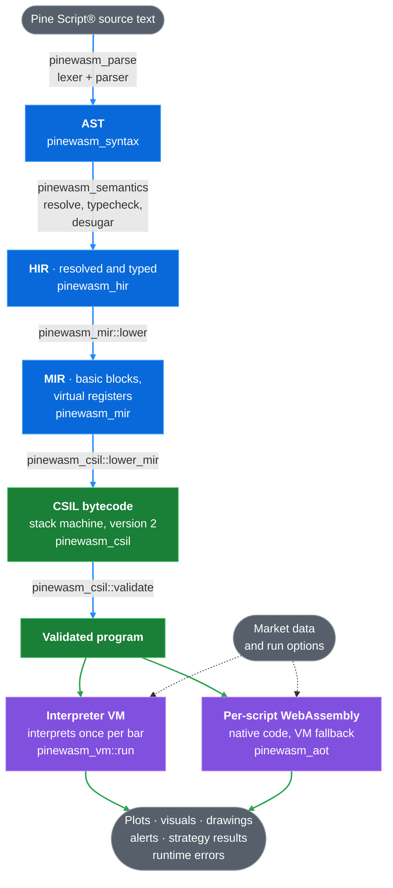

# Architecture

For a user-facing explanation of the execution routes and their performance
trade-offs, see [Understanding interpretation and WebAssembly compilation](execution-explained.md).

PineWASM is an independent compiler and deterministic virtual machine for
Pine Script® v6 source. Pine Script® is a trademark of TradingView, Inc.;
PineWASM is not affiliated with or endorsed by TradingView, Inc. Written in Rust,
the core runs natively and can also compile to WebAssembly for JavaScript hosts.
Compatibility claims are limited to the behavior that PineWASM's own tests check (see
`docs/pine-v6-coverage.md` for the tests covering each area).

The pipeline, end to end:



Blue boxes are the compiler's intermediate forms, green is the bytecode
contract, and purple is what executes it. Each box names the crate that
defines it; each arrow names the stage that produces the next one. Parsing and semantic analysis
report source diagnostics, and nothing runs unless validation accepts the
bytecode. The interpreter and the WebAssembly
backend are sibling consumers of the same validated program (see
[Why an interpreter first](#why-an-interpreter-first-with-aot-as-a-second-consumer)).

`pinewasm_compiler` orchestrates the stages and owns the DTOs that
cross the wasm boundary; `pinewasm_bindings` is a thin `wasm-bindgen`
adapter over it.

`pinewasm_lsp` is the native language-tooling host. It builds immutable
analysis snapshots from the same parser, compiler, diagnostic types, and
builtin registry, then adapts those snapshots to an editor-facing Language
Server Protocol transport. Pipeline inspection requests
call the compiler with stage-specific dump flags; there is no second AST, type
checker, linter, or IR implementation to drift from the application. See
`docs/language-server.md`.

## Why a Rust compiler core

The compiler is ordinary Rust with no browser dependencies, for four
reasons:

1. **One implementation, many hosts.** The same crates compile natively
   (for `cargo test`, property testing, and the language server) and to
   `wasm32-unknown-unknown` for the browser. Language semantics are
   defined once, in one place, and the core compiler/runtime Rust suite runs
   natively where debugging is cheap. A separate Node-hosted smoke test
   exercises the production WebAssembly package.
2. **Structured failure at the public boundary.** Malformed source and market
   data are designed to produce diagnostics or `RuntimeError` values. Bounded
   property tests exercise generated malformed inputs, but they are not an
   exhaustive proof over every byte string; a panic is a bug, not part of the
   public error contract. In the JavaScript binding, the panic hook reports a
   readable stack before an unexpected Wasm panic traps.
3. **Predictable native execution.** Bar-by-bar execution over long histories
   is a tight interpreter loop over `Vec<Value>`. The Rust core has no managed
   garbage-collection runtime, which gives hosts direct control over scheduling
   and memory boundaries without promising universal latency or speedups.
4. **Small, auditable dependency surface.** The workspace deliberately keeps
   dependencies narrow: infrastructure crates (`serde`, `thiserror`,
   `wasm-bindgen`) plus targeted domain helpers where reimplementing the
   behavior would be worse than owning the dependency. `str.match` is the
   current language-semantics exception: it uses `fancy-regex` for regex
   matching.

## Why the JavaScript package is WebAssembly

`cargo xtask wasm` emits `target/wasm-pkg/pinewasm_bg.wasm` plus generated
JavaScript bindings. A consumer may host that package on the main thread, in a
Web Worker, or in another compatible JavaScript runtime:

- **Wasm, not a JS port.** Compiling the Rust core to wasm avoids a
  second implementation of the language. The JS surface is a handful of
  functions — `init()`, `compile`, `compileAndRun`, `runProgram`,
  `version`, and their library-linking variants — and the generated
  TypeScript declarations describe their full high-level object graph. Pine
  `na` maps to `null`; exact 64-bit integers can map to JavaScript `bigint`.
  The values are structured-clone compatible, but a host that persists them
  as JSON must supply an explicit `bigint` codec rather than relying on plain
  `JSON.stringify`.
- **The host chooses the execution boundary.** Compilation and execution are
  synchronous, CPU-bound calls. A latency-sensitive application should use a
  worker or equivalent interruptible boundary so it can preserve responsiveness
  and terminate a runaway call beyond the VM's own instruction budget. The
  module itself does not assume a particular scheduler.
- **Resource limits complement the sandbox.** Wasm gives memory isolation;
  the VM adds deterministic instruction, stack, allocation, and output budgets
  (`docs/runtime.md`). Those limits are defense in depth, not a host-level
  cancellation mechanism. An embedding that accepts untrusted scripts should
  also use a worker or process boundary with a wall-clock timeout,
  cancellation, and output-copy limits.

## Why the IR/CSIL is custom and Pine-like

CSIL (the Chart Script Intermediate Language) is a purpose-built stack
bytecode rather than WebAssembly, LLVM IR, or Cranelift IR, because the
language's core concepts have no direct representation in a
general-purpose target:

- **Series values and history references.** `close[1]` and `x[2]` are
  reads of *earlier bars* of a time-indexed series. CSIL has dedicated
  opcodes for this (`READ_BUILTIN source offset`,
  `READ_BUILTIN_DYNAMIC source`, `READ_USER_SLOT slot offset`,
  `READ_USER_SLOT_DYNAMIC slot`, `STORE_USER_SLOT_CURRENT slot`), so the
  storage model — one bounded history ring per user slot — is part of the
  runtime contract. In LLVM/Cranelift/wasm this would dissolve into loads
  and stores against a runtime library, losing the structure that the
  validator and debugger tabs rely on. Each power-of-two ring is sized to
  the program's observable history depth: `max_bars_back`, literal offsets,
  and validated window lengths. Literal offsets past the 5000-bar buffer limit
  fail at compile time (`E0233`); excessive dynamic offsets fail at runtime.
  This keeps user-slot memory bounded independently of the number of bars and
  is shared by the interpreter and AOT tiers (`docs/runtime.md`).
- **Plot effects.** `plot(...)` is an effect, not a value; `PLOT_F64`
  writes the current bar's cell of a declared plot slot. Keeping it as a
  first-class opcode makes output well-defined per bar and trivially
  auditable.
- **Bar-by-bar execution.** The unit of execution is "run `main` once
  per bar". A general-purpose IR would encode the bar loop inside the
  program; CSIL keeps the loop in the VM — which is exactly where
  realtime rollback and `varip`, both now implemented and tested, did
  hook in, with no CSIL changes (`docs/runtime.md`). The AOT backend wraps the
  same per-bar contract in a native Wasm loop; realtime rollback remains on
  the interpreter path.
- **Spans everywhere.** Every CSIL instruction carries a source span
  (one span per instruction, by construction and validated), so runtime
  errors point at source text. Mapping spans through LLVM or wasm
  would require a parallel debug-info pipeline.
- **Resource accounting.** The VM charges a base unit per instruction and
  proportional work for scans, string processing/allocation, and other
  data-dependent operations; it also bounds the operand stack, heap, live
  string bytes, and regex work/cache state.
  Deterministic metering is straightforward over CSIL, and
  awkward to retrofit onto native or wasm codegen.
- **na as a first-class value.** Arithmetic, comparison, and Kleene
  logic over `na` are opcode semantics, not library calls.

The CSIL is versioned (`CSIL`, `CSIL_VERSION 2`) and validated before
execution, so it can serve as a durable artifact: hosts can cache the
compiled program and re-run it without recompiling.

Lowering removes a literal push followed by a store only when the destination
has no runtime readers and is not persistent. For example, an input-group
label can remain in the editor metadata without allocating a string each bar.
Historical reads, window consumers, initialization guards and independent
branches into the store prevent removal. Input reads, nonliteral expressions
and effects remain intact; slot IDs, constant-pool entries and input metadata
are kept. Branch destinations and source spans follow the shortened code.
Resource accounting applies to the emitted instructions and actual string
allocations, so newly compiled dead code no longer consumes those budgets.
Previously serialized programs retain their original execution semantics.
The lowering and VM tests named `dead_literal_*` cover branch remapping and
observable execution.

## Why an interpreter first, with AOT as a second consumer

The VM (`pinewasm_vm`) is a straightforward match-loop interpreter
over validated CSIL. That is a deliberate interpreter-first design:

- Correctness first: interpreter semantics are centralized in one directly
  testable execution path. Every na rule, limit, and error path can be pinned
  without relying on a second implementation.
- Metering and structured errors are trivial: budget checks and
  `RuntimeError { kind, message, bar_index, instruction_offset, span }`
  live in one loop.
- The interpreter remains the semantic baseline and universal execution
  path; the AOT tier accelerates the programs and operations it can prove safe.

Because CSIL is validated, versioned, and has fully specified opcode
semantics, the compiling backend is an *alternative consumer* of the same CSIL
rather than a replacement for the interpreter. `pinewasm_aot` lowers a
validated `CsilProgram` to a
per-script WebAssembly module, emitting bytes directly with `wasm-encoder`.

The split that makes it tractable is the one CSIL's own design anticipated.
Pure computation over the numeric/bool/color domains lowers to native wasm
instructions and typed lanes in linear memory. Numeric functions, the
stateful `ta.*` engine, and (for standalone WebAssembly strategy artifacts) the shared broker are
linked into the emitted module, and fired
`alertcondition` events use an output lane. A native module therefore imports
at most `host.vm`, which executes the residual string, effect, request, or
heap sites described by the artifact's host-site plan. Supported collection
and UDT patterns use the bounded native heap instead of crossing that boundary.

Programs outside the strict native subset get a fixed module whose `run`
delegates to `host.interpret`, so every valid program still has a `.wasm`
artifact. Close-only chart strategies can lower natively with the broker
behind explicit `host.vm` sites; the host returns the full strategy result.
Strategies requesting unsupported recalculation modes remain hosted. The
narrower standalone WebAssembly export can lower eligible strategies natively
by linking the shared broker. Realtime and
profiled requests also stay on the interpreter run path. Universal packaging
is not an acceleration or standalone-host guarantee;
`compile_standalone_program` is the separate zero-import gate.

The interpreter stays the baseline. Eligible fixtures in the
differential suite are checked for bit-identical output across both tiers; a
disagreement within that covered subset is a bug in the compiled tier. The
coverage matrix and AOT documentation state the boundaries of that evidence.
See `docs/aot.md` and the normative `docs/spec/csaw-module-abi.md`.

## Crate map

- **`pinewasm_num`** — The `no_std` numeric authority shared by the VM
  and emitted artifacts. It pins transcendental behavior so native,
  WebAssembly, and AOT results use the same implementation.
- **`pinewasm_ta`** — The allocation-free `no_std` technical-analysis
  engine shared by the VM and linked AOT runtime, including its state-layout
  planner and call declarations.
- **`pinewasm_broker`** — The `no_std` strategy broker shared by
  the interpreter and native standalone WebAssembly strategy artifacts, including order fills,
  risk rules, position state, and report aggregates.
- **`pinewasm_span`** — Foundation crate: `SourceId`, byte-offset
  `Span`s, line/column conversion, and structured `Diagnostic`s
  (severity, stable code, labeled spans, notes). Every later layer
  carries these spans. It also holds the bounded list every stage
  reports into (`Diagnostics`): the first 1,000 errors and the first
  1,000 warnings are kept, the rest are only counted, and a list that
  left some out ends with `E0002` or `W0007`. A stage asks the list what
  was reported, never what was kept, so what it decides does not depend
  on the limits. Must stay free of JavaScript, Wasm, and
  compiler-pipeline dependencies.
- **`pinewasm_syntax`** — Token and AST definitions for the surface
  syntax. Defines *what the syntax is*; contains no lexing or parsing
  logic. Every node carries a `Span`. Includes the optional AST debug dump
  exposed to native and WebAssembly callers.
- **`pinewasm_parse`** — Hand-written, indentation-aware lexer
  (Python-style `Indent`/`Dedent` synthesis, tabs = 4 columns) and
  recursive-descent parser. Both are total over arbitrary input:
  malformed source yields diagnostics and a best-effort AST. Both also
  bound what they build from it: a source over 1 MiB is not read, one that
  lexes past the token budget is not parsed (`E0001` and an empty result
  either way), and expressions, blocks and declared types each stop
  nesting at 200 levels (`E0110`). The two report into one bounded list
  of diagnostics.
- **`pinewasm_hir`** — The typed, resolved HIR: types and Pine-style
  qualifiers (`const < input < simple < series`), symbols with series
  slots, plot slots, builtin series, and HIR statement/expression nodes.
  Data definitions only; the code that builds HIR lives in semantics.
- **`pinewasm_semantics`** — Name resolution, type and qualifier
  checking, AST → HIR lowering, and the data-driven builtin registry
  (`plot`, `indicator`, the stateful `ta.change`/`ta.sma`, the pure
  `math.*`/`na`/`nz` functions and the `math.*` constants, OHLCV series,
  `bar_index`, plus "did you mean" suggestions, searched for within a
  fixed budget per compile). Total: always returns a
  (possibly partial) HIR plus diagnostics.
- **`pinewasm_mir`** — Mid-level IR: virtual registers, basic blocks,
  explicit terminators, explicit series/plot effect instructions, and
  the shared runtime `Value` model
  (`Na`/`Bool`/`Int`/`Float`/`String`/`Color`/`Ref` with its JSON
  mapping) plus the per-run collection `Heap` the `Ref` handles index.
  Contains HIR → MIR lowering and the MIR dump.
- **`pinewasm_csil`** — CSIL: the versioned stack bytecode
  (`CsilProgram`, `CsilInstr`), MIR → CSIL lowering, the human-readable CSIL
  dump, and the validator (structural bounds plus abstract stack
  interpretation). See `docs/ir.md`.
- **`pinewasm_vm`** — The deterministic CSIL interpreter: bar loop,
  user series slots, plot slots, shared strategy broker, na semantics,
  resource limits, and structured runtime errors. It is PineWASM's
  semantic baseline for CSIL programs. See `docs/runtime.md`.
- **`pinewasm_aot`** — The ahead-of-time backend: validated CSIL to a
  per-script `.wasm` module, emitted as raw bytes through `wasm-encoder`
  (no third-party IR, no external optimizer — instruction selection is
  ours). Native codegen over the proven opcode surface; an
  interpreter-hosted module that delegates `run` back to the VM for
  everything else, so every valid program has an artifact and the VM stays
  the single semantic authority. See `docs/aot.md` and
  `docs/spec/csaw-module-abi.md`.
- **`pinewasm_compiler`** — Pipeline orchestration and the public
  compile/run API: `compile`, `compile_and_run`, `version_info`, the
  `CompileOptions`/`CompileResult`/`RunResult` DTOs, the 1 MiB defensive
  source-size cap (the parser's own, applied here before the library table
  is read), and internal-error (`E9999`) wrapping of impossible
  lowering/validation failures. The exact supported native embedding boundary
  and its stability posture are inventoried in [rust-api.md](rust-api.md).
- **`pinewasm_lsp`** — The native language-tooling host: immutable
  per-revision analysis snapshots built from the same parser, semantics,
  diagnostics, and builtin registry, adapted to an editor-facing LSP
  transport over stdio, plus the scriptable `check`, `inspect`, and
  `migrate` commands. It adds no second model of the language. See
  `docs/language-server.md`.
- **`pinewasm_migrate`**: Source-to-source migration of Pine v5 into v6.
  It deliberately sits beside the pipeline rather than inside it: the
  compiler stays v6-only, and this crate carries the rewrite rules for v5
  constructs (removed parameters, qualifier inference, evaluation order) that the
  migration applies. It depends only on the parser, so it cannot drift from
  the syntax the compiler accepts. See `docs/migration.md`.
- **`pinewasm_search`** — Ripgrep-compatible search over bounded in-memory
  workspaces supplied by an embedding host.
- **`pinewasm_bindings`** — The JavaScript/WebAssembly binding layer.
  Serialization shims only (Pine `na` and non-skipped `None` values mapped to
  `null`, fields with an explicit Serde omission rule left absent, and exact
  wide integers mapped to `bigint`), generated TypeScript contracts,
  a panic hook, and the
  compiler, execution, AOT/standalone WebAssembly, language-tooling, incremental-session, and
  in-memory-search exports documented in `docs/browser.md`.

## Dependency DAG

Arrows point from a crate to the crates it depends on (normal
dependencies; dev-dependencies for tests omitted):

```text
pinewasm_num                           (no internal deps)
pinewasm_broker                        (no internal deps)
pinewasm_search                        (no internal deps)
pinewasm_span                          (no internal deps)
pinewasm_ta        → num
pinewasm_syntax    → span
pinewasm_parse     → span, syntax
pinewasm_hir       → broker, span, ta
pinewasm_semantics → span, syntax, hir
pinewasm_mir       → span, hir
pinewasm_csil      → span, hir, mir
pinewasm_vm        → broker, span, hir, mir, csil, num, ta
pinewasm_aot       → hir, csil, num, ta
pinewasm_compiler  → broker, span, syntax, parse, hir, semantics, mir, csil, vm
pinewasm_migrate   → span, syntax, parse
pinewasm_lsp       → span, syntax, parse, hir, semantics, compiler, migrate
pinewasm_bindings → compiler, vm, aot, num, lsp, search (migrate: optional)
pinewasm_xtask                         (repository automation; no internal crate deps)
```

Properties worth preserving:

- The DAG is layered: syntax crates do not see semantic crates, IR
  crates do not see the pipeline, and nothing below `pinewasm_bindings`
  sees JavaScript or WebAssembly binding concerns.
- `pinewasm_hir` is the semantic vocabulary shared downward: MIR, CSIL,
  and the VM reuse its `BinOp`/`UnOp`/`BuiltinSeries`/slot types instead
  of redeclaring them.
- `pinewasm_mir` owns `Value` so the VM and CSIL agree on the runtime
  value model without depending on each other's internals.
- `pinewasm_vm` and `pinewasm_aot` are sibling consumers of
  validated CSIL; neither depends on the other. The compiling tier can
  gain or lose coverage without touching the interpreter that defines the
  semantics.

## The host-agnostic core rule

Only `pinewasm_bindings` may depend on `wasm-bindgen`,
`serde-wasm-bindgen`, `console_error_panic_hook`, or any other
JavaScript-facing crate. Everything else — including
`pinewasm_compiler`, which defines the DTOs that cross the boundary —
is plain Rust that compiles and tests natively.

Consequences of the rule:

- All language and runtime semantics are testable with `cargo test`
  natively; the wasm crate adds no behavior to test beyond
  serialization.
- The boundary types (`CompileResult`, `RunResult`, `Diagnostic`,
  `RuntimeError`, plot values) are ordinary `serde` types; their serialized
  shape is the wire contract. `pinewasm_bindings` maps `Value::Na` and
  non-skipped `Option::None` fields to `null`; fields declared optional in the
  generated TypeScript contract are omitted when their Serde omission rule
  applies. Wide integer fields stay JavaScript `bigint` rather than being
  rounded through `number`.
- Alternative hosts — the language server, the `check`/`inspect`
  commands, the test suites — call `pinewasm_compiler` directly and
  get identical behavior.
