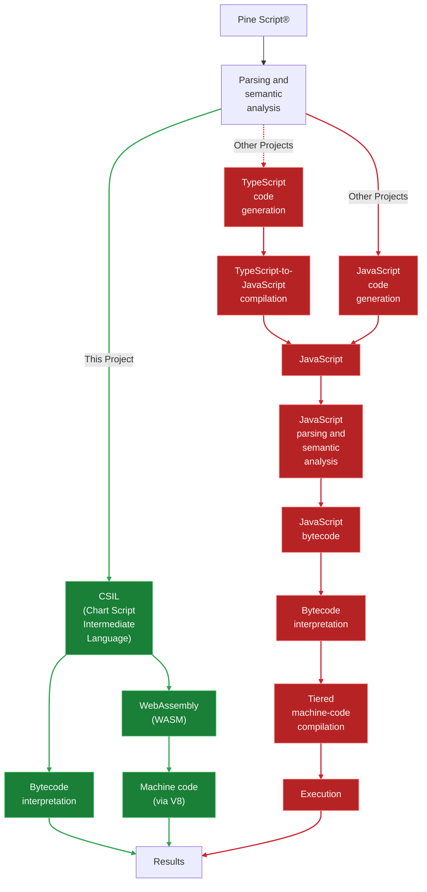

# Understanding interpretation and WebAssembly compilation

PineWASM can interpret a script's instructions or compile supported scripts to
WebAssembly. In a V8-based host such as Chrome, Edge, or Node.js, **V8 participates
in both routes**. The difference is whether it executes the interpreter or code
generated specifically for your script.

## The execution routes

Both PineWASM routes start with Pine-compatible source and produce **CSIL**
(Chart Script Intermediate Language), PineWASM's validated bytecode format.
Bytecode is
a sequence of instructions for a software runtime, rather than CPU instructions.



The green routes are PineWASM's interpreted and compiled routes;
the red routes illustrate how other projects may reach execution through
JavaScript, with or without a TypeScript stage in between. It is a conceptual
comparison, not a claim that every transpiler implements these exact stages. The
JavaScript branch depicts execution that tiers up to machine code; JavaScript can
also produce results without tiering up. A TypeScript stage is shown only as one
path other projects may take; it is not implied merely because a transpiler is
implemented in TypeScript.

In Chrome, Edge, or Node.js, V8 also compiles and runs the Wasm containing the
PineWASM interpreter. That hosting layer is omitted from the diagram: V8
optimizes the interpreter's code on one route and the script's emitted Wasm on
the other. A shared Results node denotes completion, not identical output
contracts: the import-free compiled route supports a narrower signal surface.

In PineWASM, the source language is Pine, the validated bytecode is CSIL, and
V8 performs the machine-code compilation in a V8-based host. The compilation
branch shown here describes eligible import-free modules; its supported results
are narrower than the interpreter's full output surface.

**The interpreter does not generate bytecode or WebAssembly.** Bytecode
interpretation and WebAssembly code generation consume the same validated
program. The diagram shows how the user's script is processed; the interpreter
itself also needs executable machine code, as explained below.

| Term | Meaning here |
| --- | --- |
| Parsing | Recognizing source syntax and building a structured representation. |
| Semantic analysis | Checking names, types, and language rules. |
| Lowering | Translating a program into a representation closer to execution. |
| Bytecode | Instructions for a software runtime; PineWASM calls its format CSIL. |
| Interpretation | Reading and executing those instructions at runtime. |
| Code generation | Emitting instructions for a target, such as WebAssembly. |
| Ahead-of-time compilation | Compiling before execution of the resulting artifact; here, producing WebAssembly. |
| Just-in-time compilation | Producing machine code at runtime; V8 normally does this for WebAssembly. |

## Why the interpreter route still uses V8

For browser use, the Rust compiler and VM are themselves built into a Wasm
package. V8 compiles that package's executable code to machine code. When the VM
runs a script, it reads the script's CSIL instructions as data and performs the
requested operations.

There are therefore two distinct layers:

```text
Package execution: Rust VM → built as Wasm → V8 → CPU executes the interpreter
Script execution: Pine → CSIL → that interpreter processes instructions → results
```

V8 can optimize the interpreter's dispatch loop and helper functions, subject to
its optimization rules. This does not imply that it reconstructs and compiles
the individual Pine strategy from the CSIL data. The repeated work of fetching,
decoding, and dispatching CSIL instructions remains part of this route.

## What changes with WebAssembly code generation

For eligible programs, WebAssembly code generation turns the script's operations into executable Wasm
instructions. Shared numeric routines, technical-analysis routines, and the
broker needed by supported strategies are linked into the artifact.

```text
Source → bytecode → WebAssembly code generation → Wasm
Wasm → machine-code compilation → machine code → execution → results
```

This has **two main compilation stages**:

1. PineWASM translates Pine through CSIL into WebAssembly.
2. The host engine translates WebAssembly into CPU machine code.

V8 can now optimize the script's emitted operations directly. Removing much of
the interpreter dispatch creates an opportunity for faster execution; it is
not a guarantee that every script or short run will be faster.

## Does V8 do loop unrolling and other optimizations?

Yes. V8 normally starts Wasm functions with its fast baseline compiler,
**Liftoff**, and optimizes hot functions with **Turboshaft**. See the
[V8 WebAssembly architecture](https://chromium.googlesource.com/v8/v8/+/main/docs/wasm/architecture.md).

Its optimizer can inline eligible function calls, simplify constant expressions,
and eliminate repeated computations. See V8's
[Wasm optimization explanation](https://v8.dev/blog/wasm-speculative-optimizations).

It also supports **loop unrolling**: duplicating a loop body so less loop-control
work is needed. Small loops with known iteration counts can qualify for full
unrolling; other small loops can qualify for partial unrolling. Size, calls,
and nesting affect eligibility. See the
[V8 unrolling implementation](https://chromium.googlesource.com/v8/v8/+/refs/heads/main/src/compiler/turboshaft/loop-unrolling-reducer.h).

These are engine capabilities, not proof that a particular generated loop received
them. Engine versions, settings, code shape, and warmup matter. Confirming an
individual transformation requires compiler traces or machine-code inspection.

## What about running the Rust VM natively?

The native Rust VM runs as machine code produced by the Rust build toolchain;
V8 is not involved. Rust's LLVM backend already performs optimizations such as
inlining and loop transformations.

Building that interpreter as Wasm and running it in V8 changes the compilation
pipeline. It does not automatically make the native interpreter faster. Either
could win for a particular workload; that is a benchmark question. Compiling the script to WebAssembly makes a
different change: it replaces interpretation of supported script operations
with compiled operations.

V8 is also a host choice, not a requirement of the generated module. Other Wasm engines can execute
the artifact; PineWASM's import-free module tests use Wasmi. Running a browser package does not
imply V8 in every browser.

## Why keep both routes?

The interpreter is the compatibility baseline and exposes the full VM result
surface. The import-free compiled route described here has eligibility
restrictions and a signal-oriented output contract.
Matching the compiled signal results does not demonstrate equality of every chart output or a
complete strategy report. Realtime and profiled requests currently remain on
the interpreter path.

PineWASM also has other AOT packaging modes that can call back into the host
interpreter. **A `.wasm` file alone is not evidence that interpretation has been
removed.** The import-free contract described here is distinct from those hosted modes.
See the [AOT guide](aot.md#12-standalone-webassembly-interfaces) and
[browser integration contract](browser.md).

An application could select compiled execution automatically when the requested behavior is
supported, cache the artifact, and use the VM for other cases. This would be a
runner that chooses between compilation and interpretation, rather than a
change that makes the interpreter itself faster.

## Comparing execution routes in an application

An application comparison mode could run the same source, market data, and inputs
through the interpreted and compiled routes. This repository provides the backend APIs, not
an embedding application; this section describes a possible integration, not a
claim that a first-party comparison UI is provided.

Such a comparison shows, for one script and workload, whether compiling to WebAssembly speeds
up the first result, repeated runs, or both. To make it meaningful:

1. **Check eligibility and correctness first.** Compare the same declared signal
   outputs and semantics. Report cases unsupported by compiled execution explicitly. Never silently
   substitute VM execution and label its timing as compiled execution.
2. **Separate preparation from execution.** Report source-to-CSIL compilation,
   WebAssembly code generation, engine compilation/instantiation, and data preparation separately.
   Also report total time to the first usable result.
3. **Measure first and repeated execution.** Use fresh instances for startup
   measurements and reused prepared programs for repeated-run measurements.
   State warmup and caching rules; reset per-run state so each run does the same
   work. A single long first call need not benefit from optimized code that
   becomes available while it is running.
4. **Keep the environment comparable.** Use the same browser, worker environment,
   dataset, input values, and comparable output requests. Account for copying,
   serialization, and extra VM outputs rather than attributing all elapsed-time
   differences to instruction execution.
5. **Report distributions and scope.** Alternate run order, collect multiple
   samples, and show median timings and variability with engine and artifact
   versions. State whether the result measures startup, repeated execution, or
   the full application experience.

The result holds for that script and workload only. Published performance claims follow the
[benchmark methodology](benchmarks.md).
